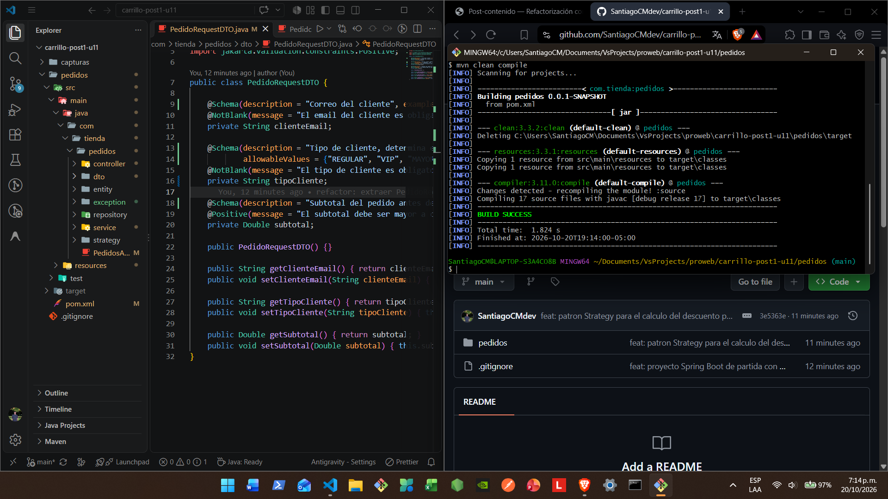
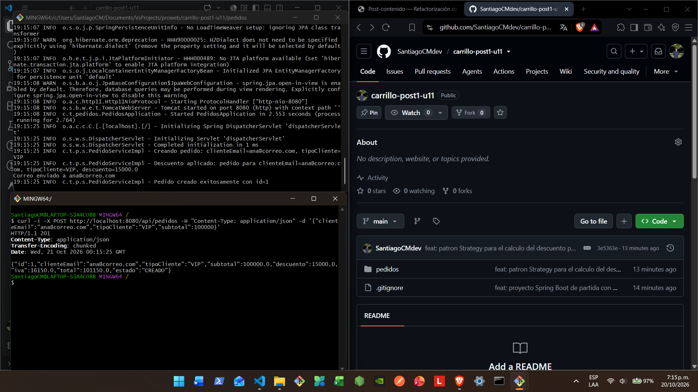
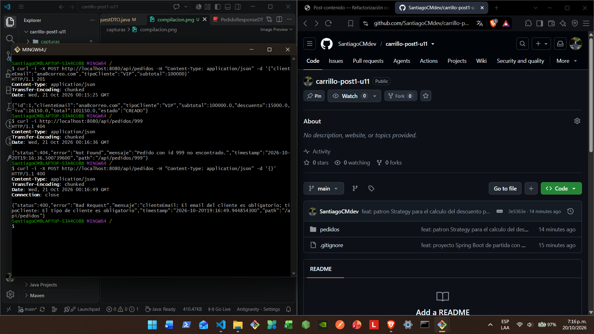
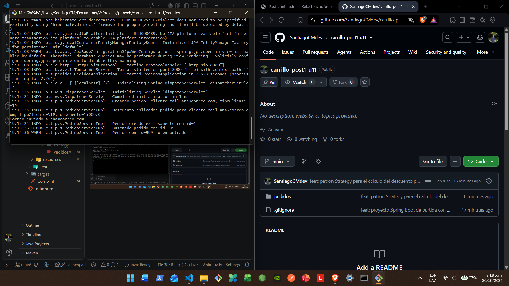
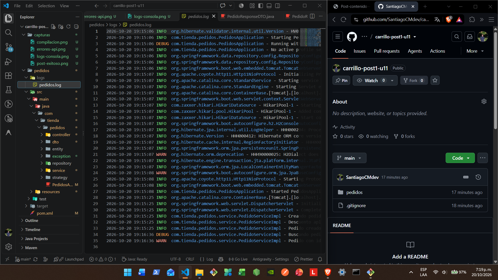
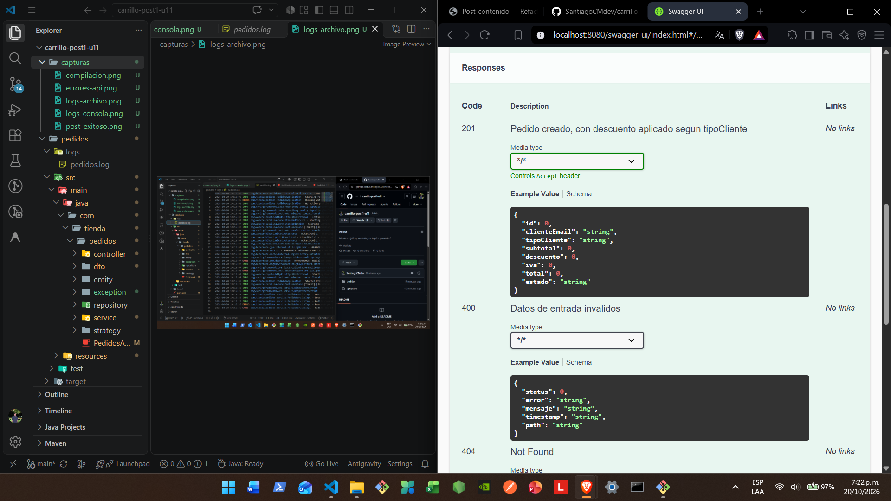

# Post-contenido - Unidad 11: Buenas Prácticas y Patrones de Diseño

**Estudiante:** Santiago Eduardo Carrillo Molina  
**Código:** 02230132036  

## Descripción
Repositorio del laboratorio de la Unidad 11 de Programación Web - Séptimo Semestre. Contiene un único proyecto Maven Spring Boot (`pedidos/`) que parte de un código con violaciones reales de SOLID (SRP y DIP), SQL embebido y una entidad JPA expuesta directamente en la API, y lo refactoriza aplicando arquitectura en capas, el patrón DTO, inyección de dependencias por constructor y el patrón Strategy para el descuento por tipo de cliente. Se extiende con logging (SLF4J/Logback) y documentación de la API (springdoc-openapi/Swagger).

## Decisiones de diseño
- **Strategy en vez de un segundo patrón creacional para la conversión DTO:** el descuento tiene variación real de comportamiento (OCP); la conversión entidad-DTO es un mapeo simple resuelto en un método privado del servicio, evitando sobre-ingeniería.
- **El registro del descuento aplicado vive en un único punto de `PedidoServiceImpl`:** no en cada Strategy, para no dispersar el rastro de auditoría en tres clases distintas.
- **`notasInternas` nunca se registra en los logs ni se expone en el DTO de respuesta:** por ser información operativa interna.

## Parte 1 - Refactorización con SOLID, DTO y Strategy
El código de partida tenía un `PedidoController` con SQL embebido, un método `crearPedido` que violaba SRP (validaba, calculaba, persistía, notificaba y registraba en un solo bloque), una dependencia de notificación creada con `new`, y devolvía la entidad `Pedido` completa como respuesta JSON. Se extrajeron `PedidoRepository` (DAO vía `JpaRepository`), `PedidoService`/`PedidoServiceImpl` (DIP por constructor), `PedidoRequestDTO`/`PedidoResponseDTO` (sin `notasInternas`), y el patrón Strategy (`EstrategiaDescuento` con implementaciones `Regular`/`Vip`/`Mayorista`) inyectado como `Map<String, EstrategiaDescuento>`.

## Parte 2 - Manejo de Errores, Logging y Documentación
`GlobalExceptionHandler` con `@RestControllerAdvice` reemplaza el `try/catch` disperso del código de partida, capturando `RecursoNoEncontradoException` (404), `MethodArgumentNotValidException` (400) y `Exception` genérica (500). `PedidoServiceImpl` registra sus eventos con SLF4J usando placeholders y niveles `INFO`/`WARN`/`DEBUG`. `logback-spring.xml` configura un appender de consola y un `RollingFileAppender` con rotación diaria y 30 días de historial en `logs/pedidos.log`. La API está documentada con `springdoc-openapi`, visible en Swagger UI en `/swagger-ui.html`.

## Cómo compilar y ejecutar
1. Clonar el repositorio: `git clone https://github.com/TU_USUARIO/carrillo-post1-u11.git`
2. Ejecutar `mvn spring-boot:run` dentro de `pedidos/`
3. Probar los endpoints con Postman o curl en `http://localhost:8080/api/pedidos`
4. Consultar los logs en consola y en `pedidos/logs/pedidos.log`
5. Abrir la documentación interactiva en `http://localhost:8080/swagger-ui.html`

## Capturas de pantalla

